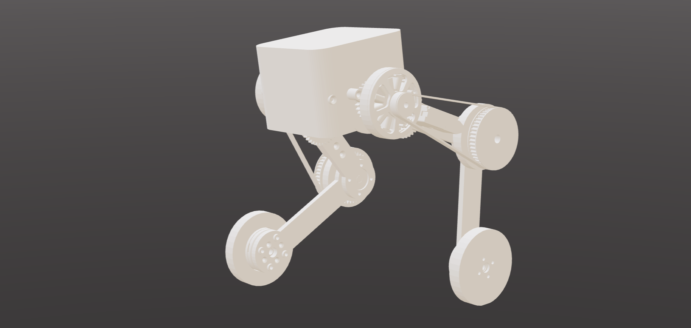

# ria

ria is a small wheeled biped built for jumping and fast ground motion.



### bom

- 2x 5010 260kv bldc
- 2x gbm2804 145kv bldc
- 2x sg90 servo
- control pcb: 4x ss6343m, doit esps3-32-n4, tokmas icm-42688-p, ap63300
- 4x as5600
- funfly 1300 4s lipo
- m2, m3 screws
- 6x 693zz bearings (planet gears)
- 2x gt3 300 mm closed belt

### specs

- 10:1 two stage knee transmission
- 100mm upper and lower legs
- 720g mass
  - 150g/side motors, 200g plastic, 150g battery, 70g everything else
- 20cm jump height, 30kmh top speed (tentative, accurate-ish)

# printed parts
ria is built mostly from parts designed in cadquery. nearly every part has a flat face so it should be easy to 3d print. you'll need some m3 screws of various sizes and some 693 bearings.

```bash
cd models
python3 main.py
```

# pcb
backplane opens the [pcb from pr #5](hardware/oct05-mincaps/ria-backplane-mincaps/pcb/ria.kicad_pro): 50×69.45mm, four copper layers, four ss6343m motor drivers, a doit esp32-s3 module, four encoder headers, usb-c, horizontal xt60 and an imu. its 198 routing vias have 0.3mm drills and no holes inside solder pads; epoxy filling and copper capping are unnecessary for this layout. see [the review](hardware/oct05-mincaps/review-2026-10-14.md) for fresh checks, connector correction and pricing. firmware and sustained-current temperatures need bench verification.

`pcb/` retains the separate drv8316ct sensorless revision. `ts-pcb/` preserves the original tscircuit source.

# software
ria is trained and driven in [botblocks.dev](https://botblocks.dev)

```bash
cd software
botblocks import robot bot.json --save myriafork/robot --root ..
botblocks run drive.py
```
